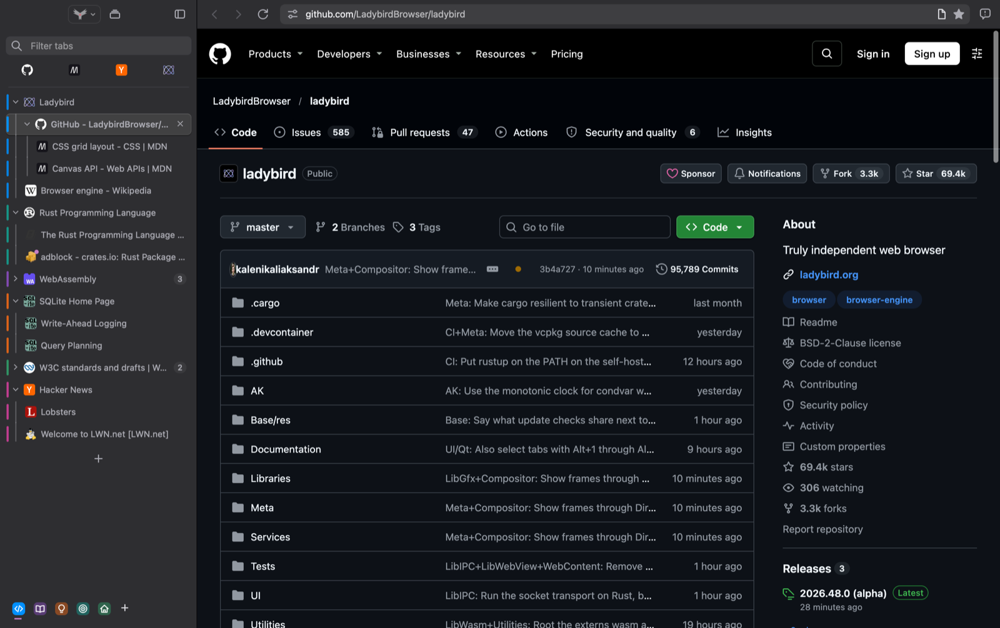
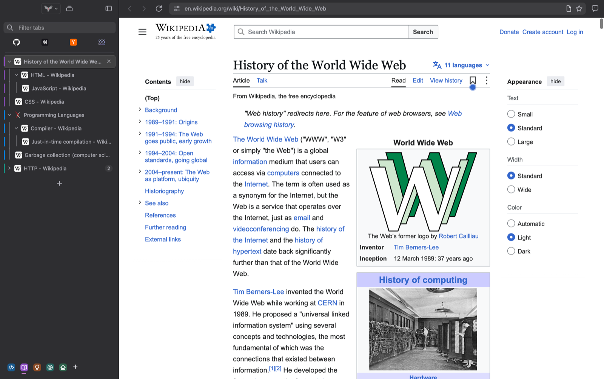
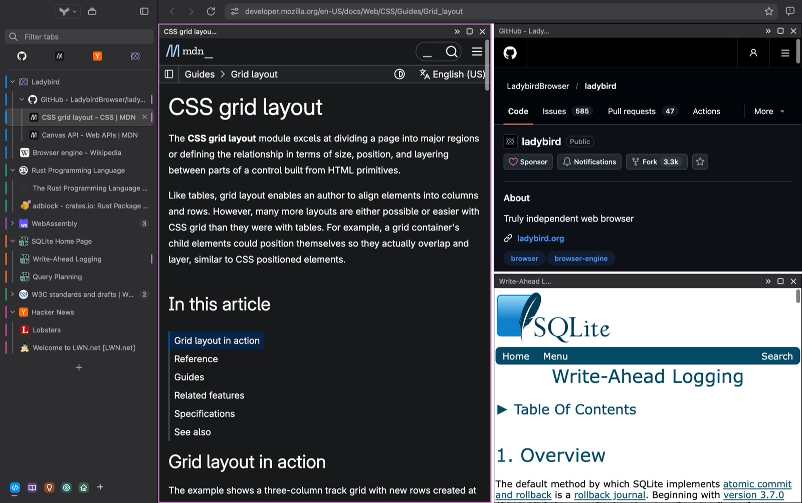
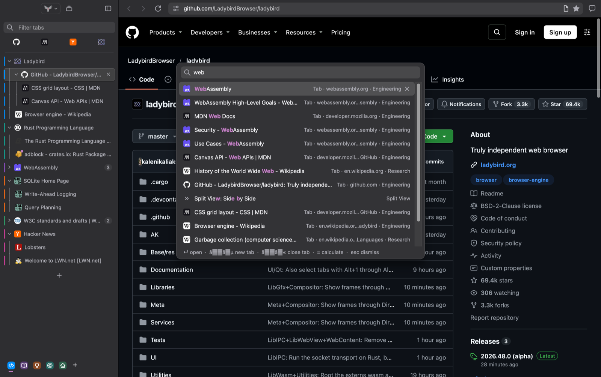
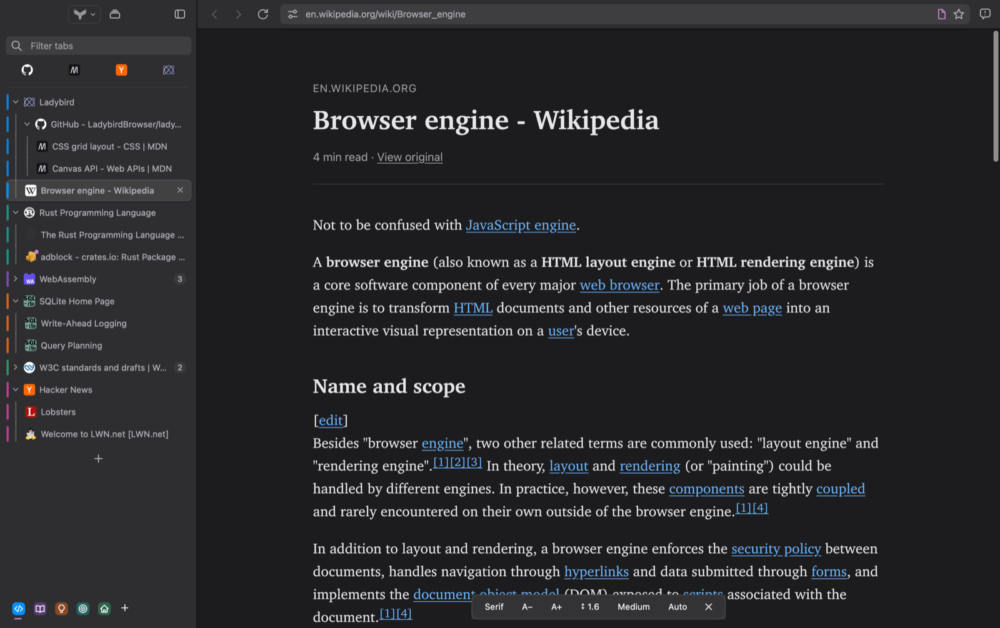
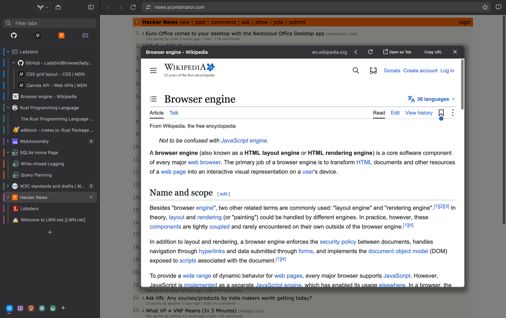
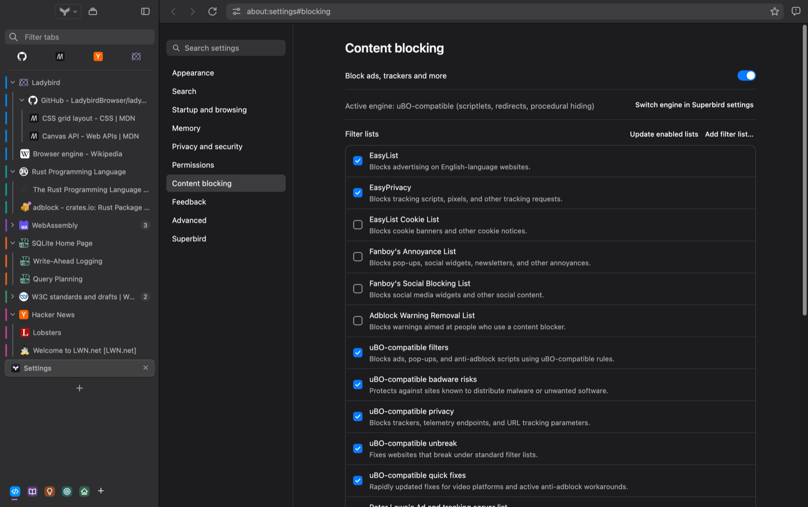
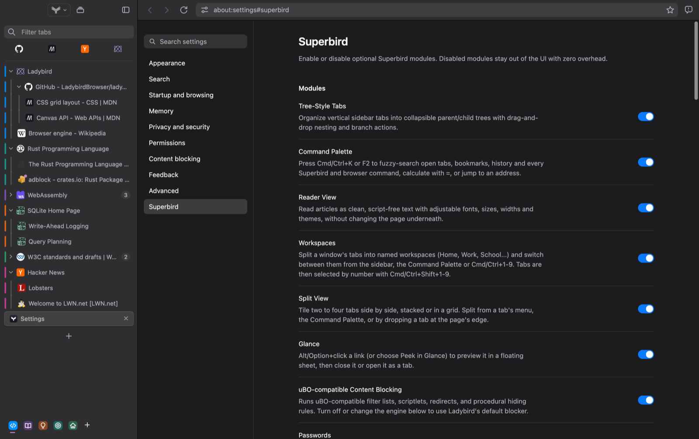

# Superbird

A modular fork of the [Ladybird](https://github.com/LadybirdBrowser/ladybird) browser with pick-and-choose power features you can turn on or off anytime.

Superbird runs safely side-by-side with stock Ladybird using its own app bundle, profile directory, and settings — with upstream auto-updates disabled so it never overwrites itself.



## Features

### Tree-Style Vertical Tabs
Keep dozens of tabs manageable in a collapsible tree. Nest child tabs automatically as you browse, tag branches with colors, collapse subtrees with descendant counts, filter tabs inline, and keep pinned tabs in a compact grid at the top.

### Workspaces
Separate your browsing into named, color-coded spaces (like Engineering, Research, Design, or Personal) without opening extra windows. Switch with the sidebar bar, the Command Palette, or `Cmd/Ctrl+1–9` (`Cmd/Ctrl+Shift+1–9` switches tabs). Pinned tabs stay visible across every workspace.



### Split View
Tile 2 to 4 tabs side by side, stacked, or in a grid inside one window. Split from a tab's context menu, the Command Palette, or by dragging a tab to any edge of the page.



### Command Palette
Press `Cmd/Ctrl+K` (or `F2`) to fuzzy-search open tabs across every workspace and branch, bookmarks, history, and browser commands — or type `=` to evaluate quick math inline.



### Reader View
Read articles as clean, script-free text without changing or losing your place on the original page. Trigger it from the address-bar icon or with `Ctrl+Cmd+R` (macOS) / `Ctrl+Alt+R` (Linux), and adjust font, size, line spacing, column width, and theme on the fly.



### Glance
`Alt/Opt+Click` any link (or right-click → **Peek in Glance**) to preview it in a floating sheet without cluttering your tab tree. Click **Open as Tab** to keep it, or press `Esc` to dismiss.



### uBO-Compatible Content Blocking
Built on `adblock-rust` with 9 filter lists enabled out of the box (uBO's default lists plus EasyList and EasyPrivacy), auto-refreshing subscriptions, scriptlets, cosmetic filtering, and a live switch between the uBO-compatible blocker and Ladybird's default engine.



### Modular by Design
Every feature lives behind its own toggle in `about:settings#superbird`. Turn a module off and it leaves zero UI clutter behind — or strip modules out at compile time with `-DSUPERBIRD_MODULE_<NAME>=OFF`. You can also configure per-module options and custom keyboard shortcuts from the same page.



## Quick Start

```sh
git clone https://github.com/CainCosta/Superbird.git && cd Superbird
make setup        # install dependencies, upstream submodule, Rust toolchain, and patches
make run          # build and launch Superbird
make test         # run fast unit and settings checks
make install      # build and install portable Superbird.app into /Applications (macOS)
```

For architecture notes, patch workflow, module development, and upstream rebasing, see [DEVELOPING.md](DEVELOPING.md).

## What's Next

See [ROADMAP.md](ROADMAP.md) for the full plan and `docs/design/` for design specs.

- Compact / auto-hide toolbar mode
- Persistent web panels and a local Markdown scratchpad
- Auto-archive for inactive tabs
- Named session snapshots and export
- Vim mode and keyboard link hints
- Per-site custom styles (boosts) and command chains

## License

BSD-2-Clause, the same license as the Ladybird fork it builds on. Bundles ship a `LICENSES.txt` covering Ladybird, Superbird, and third-party dependencies. See [LICENSE](LICENSE).
